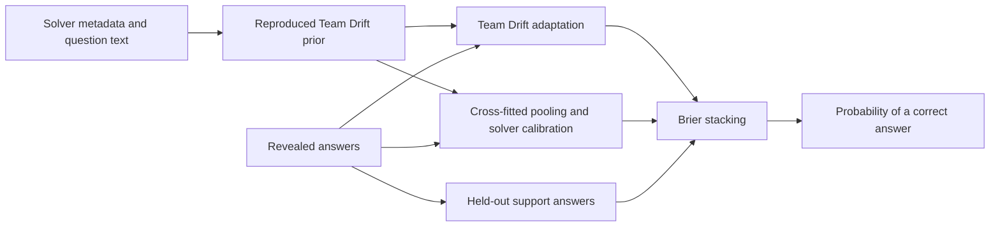

<h1 align="center">Predicting Unfamiliar Solvers</h1>
<p align="center"><strong>Cross-Fitted Probability Pooling</strong></p>
<p align="center">AIMS / NeurIPS 2026 PAIEC · Codabench submission <code>1022433</code></p>
<p align="center">
  <a href="report/aims_report.pdf"><strong>Read the paper</strong></a> ·
  <a href="#quickstart">Run the model</a> ·
  <a href="submission/">Get the submission</a> ·
  <a href="REPRODUCING.md">Reproduce the results</a>
</p>

---

How likely is an unfamiliar solver to answer a question correctly after seeing only a handful of its answers? This predictor starts from a prior based on solver metadata and question text, then adapts as answers are revealed. It shares question-level evidence across solvers and combines two adapted probabilities using a weight fitted on held-out revealed answers.

## Results

| Evaluation | Brier ALC ↓ | Brier after 31 answers ↓ |
|:--|--:|--:|
| **Hosted Codabench · submission 1022433** | **0.190208** | **0.155706** |
| Local benchmark-excluded development · ten solvers | 0.151344 | 0.071451 |
| Oracle diagnostic · four-coordinate question positions | — | 0.046928 |

Lower is better. Brier ALC summarizes the learning curve across answer budgets. The 31-answer score measures its endpoint.

> [!NOTE]
> Each row uses a different evaluation protocol. The oracle uses historical answers to locate questions. Predicting those positions from new question text remains an open problem. The [paper](report/aims_report.pdf) details the protocols, paired comparisons, and confidence intervals.

## How it works



When calibrating against a revealed answer, the benchmark shift leaves out the entire item and the pooling counts leave out that answer. The stacking weight is then selected by scoring the two adapted estimates on held-out support answers.

## Quickstart

Install the runtime dependencies with Python 3.11 or newer, then run the smoke test. Inference runs on CPU and works offline once NumPy and SciPy are installed.

```bash
python -m pip install -r requirements.txt
python scripts/smoke_test.py
```

Call `model.predict([subject, item], labeled)` to get a Python float between 0 and 1. Each entry in `labeled` has the form `[[subject, item], outcome]`, where the outcome is 0 or 1. The [smoke test](scripts/smoke_test.py) includes a complete synthetic example and checks deterministic predictions and benchmark isolation with network access blocked.

<details>
<summary><strong>Check the exact submitted archive and reproduce the result tables</strong></summary>

```bash
python scripts/check_submission.py
python -m pip install -r requirements-research.txt
python scripts/verify_results.py
```

The archive check runs 168 reference cases in isolation. The results script recomputes reported statistics from released records. See the [reproduction guide](REPRODUCING.md) for prior training and the prerequisites for the original experiments.

</details>

## Repository guide

| Path | What's inside |
|:--|:--|
| [`report/`](report/) | Paper, LaTeX source, and figures |
| [`submission/`](submission/) | Exact Codabench upload and its SHA-256 checksum |
| [`results/`](results/) | Development scores, frozen splits, oracle records, and hosted budget means |
| [`research/`](research/) | Original analysis and representation-training code |
| [`artifacts/oracle/`](artifacts/oracle/) | Fitted representation arrays, source roles, and solver-identity audit |
| [`REPRODUCING.md`](REPRODUCING.md) | Inference checks, prior training, statistical verification, and experiment prerequisites |

The root runtime files and fitted payload match the submitted archive. Hidden item-level outcomes are withheld, and raw benchmark texts and response tables come from their original sources.

## Credits and license

**Idrees Aziz** · [idrees.mustafa.aziz@gmail.com](mailto:idrees.mustafa.aziz@gmail.com)

The logistic prior, feature hashing, and Gaussian baseline come from Alex Alvord / Cloud Lab Works LLC's [Team Drift implementation](https://github.com/cloudlabworks/aims-team-drift/tree/5a67dfcbaf8742f639edbfb96f15ee6efe3eed04). The [upstream MIT notice](licenses/Team-Drift-MIT.txt) is retained. This project adds cross-fitted item-probability pooling, solver calibration, and Brier stacking using established methods including Beta conjugacy and Gaussian shrinkage. OpenAI Codex assisted development.

The code is [MIT licensed](LICENSE). Dataset source terms and the report template's notices still apply.
