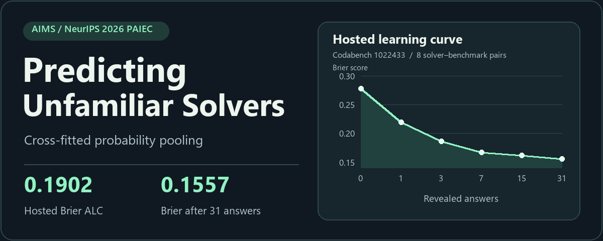

<p align="center">
  
</p>

<p align="center">
  <a href="report/aims_report.pdf"><strong>Read the paper</strong></a> &nbsp;·&nbsp;
  <a href="#run-locally">Run the predictor</a> &nbsp;·&nbsp;
  <a href="submission/">Get the submission</a> &nbsp;·&nbsp;
  <a href="REPRODUCING.md">Reproduce the results</a>
</p>

How well can an AI solver answer a new question after we’ve seen just a few of its answers? This AIMS / NeurIPS 2026 PAIEC entry predicts the probability of a correct answer using question text, solver metadata, and revealed answers from the solver and its peers.

## Results

| Evaluation | Brier ALC ↓ | Brier at 31 answers ↓ |
|:--|--:|--:|
| **Hosted Codabench · submission 1022433** | **0.190208** | **0.155706** |
| Local development · benchmark excluded, ten solvers | 0.151344 | 0.071451 |
| Oracle diagnostic · four-coordinate question positions | — | 0.046928 |

Lower scores are better. The banner shows the [hosted budget means](results/hosted_budget_means.json), with evaluated budgets spaced evenly. The three rows use different protocols. The oracle locates questions using historical answers. Recovering those positions from new question text remains open. The [paper](report/aims_report.pdf) gives the protocols, paired comparisons, and confidence intervals.

## Run locally

Python 3.11+ with NumPy and SciPy. Inference runs offline on CPU once dependencies are installed.

```bash
python -m pip install -r requirements.txt
python scripts/smoke_test.py
```

`model.predict([subject, item], labeled)` returns a Python float between 0 and 1. Each entry in `labeled` is `[[subject, item], outcome]`, with a binary outcome. The [smoke test](scripts/smoke_test.py) shows a complete synthetic call and checks determinism and benchmark isolation with network access blocked.

<details>
<summary><strong>Verify the submitted archive and reproduce the tables</strong></summary>

```bash
python scripts/check_submission.py
python -m pip install -r requirements-research.txt
python scripts/verify_results.py
```

The archive check compares 168 reference cases in isolation. The results script recomputes statistics from released episode records. For prior training and original experiment prerequisites, see the [reproduction guide](REPRODUCING.md).

</details>

## How the predictor learns

1. **Start with a prior.** Team Drift’s reproduced logistic model uses solver metadata and question text.
2. **Adapt to revealed answers.** Team Drift’s update and a cross-fitted pooling update each estimate success. The pooling update shares evidence about questions across solvers and calibrates to the target solver.
3. **Combine the estimates.** Brier stacking chooses the blend using held-out support answers. When calibrating on a support answer, the benchmark shift excludes that item and the pooling counts exclude that answer.

## Repository guide

| Path | Contents |
|:--|:--|
| [`report/`](report/) | Paper, LaTeX source, and figures |
| [`submission/`](submission/) | Exact Codabench archive and SHA-256 checksum |
| [`results/`](results/) | Development scores, frozen splits, oracle records, and hosted budget means |
| [`research/`](research/) | Original analysis and representation-training code |
| [`artifacts/oracle/`](artifacts/oracle/) | Fitted representation arrays, source roles, and solver-identity audit |

The root runtime files and fitted payload match the submitted archive. Hidden item-level outcomes are withheld. Raw benchmark texts and response tables are available through their original sources.

## Credits and license

**Idrees Aziz** · [idrees.mustafa.aziz@gmail.com](mailto:idrees.mustafa.aziz@gmail.com)

The logistic prior, feature hashing, and Gaussian baseline come from Alex Alvord / Cloud Lab Works LLC’s [Team Drift implementation](https://github.com/cloudlabworks/aims-team-drift/tree/5a67dfcbaf8742f639edbfb96f15ee6efe3eed04). The [upstream MIT notice](licenses/Team-Drift-MIT.txt) is retained. This project adds cross-fitted item-probability pooling, solver calibration, and Brier stacking using established methods including Beta conjugacy and Gaussian shrinkage. OpenAI Codex assisted development.

The code is [MIT licensed](LICENSE). Dataset source terms and the report template’s notices still apply.
